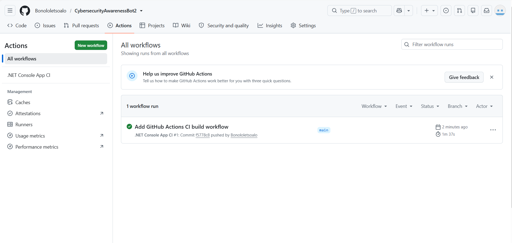

# Cybersecurity Awareness Bot

An interactive C# console application designed to teach cybersecurity fundamentals.

## Features
- Interactive quiz engine and response manager
- Custom ASCII graphics and colored UI
- WPF & XAML user interface
- Custom audio greeting player
- Different colors for the bot and user
- Memory recall
- Conversation flow
- Sentiment Detection
- Error handling

## Setup & Execution
1. Clone the repository:
   ```bash
   git clone https://github.com/Bonololetsoalo/CybersecurityAwarenessBot2.git


 ## Continuous Integration (CI)




https://youtu.be/Qve__N80_Nc

## Video Presentation

Watch the 8-minute technical walkthrough and live demonstration on YouTube for Part 2:

**Direct Link:** [Watch Video Presentation on YouTube](https://youtu.be/qf9KdtqV7jk)

git add README.md
git commit -m "https://youtu.be/qf9KdtqV7jk"
git push origin mainC
